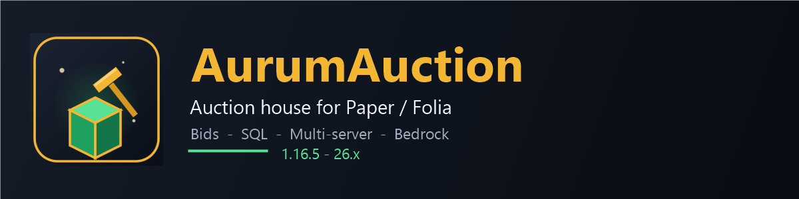

# AurumAuction

**A lightweight auction house for Paper, Purpur and Folia — 1.16.5 to 26.x.**

[](https://hangar.papermc.io/xuviga/AurumAuction)
[](CHANGELOG.md)
[](pom.xml)
[](docs/GUIDE.md)



Zero required dependencies. YAML out of the box, SQLite or MySQL when you grow.
Vault is optional and loaded through reflection.

## Features

- **GUI-first**: categories, search, pagination, six sort modes (newest, price, unit price, name).
- **Fixed-price and bid lots**: minimum increment, buyout, anti-snipe, escrow with automatic refunds.
- **Partial purchases**: `/ah buy <id> [amount]` or Shift+Click.
- **Sell menu**: drop a stack, set a price — no commands needed.
- **History, top and watchlist**: `/ah history`, `/ah top`, `/ah watch diamond`.
- **Offline-friendly**: won items and payouts are queued and delivered on join.
- **Storage**: YAML, SQLite, MySQL/MariaDB, automatic `lots.yml` migration.
- **Multi-server**: snowflake lot IDs, atomic transitions, shared MySQL table.
- **Folia**: region scheduler adapter, detected by server brand.
- **Bedrock**: trimmed lore for Geyser/Floodgate players.
- **Admin tools**: tax and limit groups, blocked materials, price bounds, auto-buyout, retention,
  transaction log, `/ah reload`.
- **Russian and English** messages.

## Install

1. Drop `AurumAuction.jar` into `plugins/`.
2. Install **Vault** and an economy plugin (EssentialsX, CMI, …).
3. Start the server, then pick a backend in `plugins/AurumAuction/config.yml`:
   - `storage.type: YAML` — small single server;
   - `storage.type: SQLITE` — large single server;
   - `storage.type: MYSQL` + `multi-server.enabled: true` — network.
4. Restart or run `/ah reload`.

## Build

Requires **JDK 21+** (bytecode targets Java 8) and Maven 3.9+.

```bash
mvn -B clean package
```

The shaded jar lands in `target/AurumAuction-0.7.0.jar` — SQLite and MySQL drivers are bundled.

## Commands

| Command | Permission |
|---|---|
| `/ah` | `auction.use` |
| `/ah sell <price> [amount]`, `/ah sellmenu <price>` | `auction.sell` |
| `/ah auction <start> [hours] [buyout]` | `auction.sell` |
| `/ah buy <id> [amount]`, `/ah bid <id> <amount>` | `auction.use` |
| `/ah search <text>`, `/ah my`, `/ah expired`, `/ah claims` | `auction.use` |
| `/ah history`, `/ah top [buyers]`, `/ah watch <text>` | `auction.use` |
| `/ah admin info\|remove\|end\|payouts\|autobuy`, `/ah reload` | `auction.admin` |

Groups: `auction.group.<name>` for tax and lot limits, `auction.limit.<n>`, `auction.tax.bypass`,
`auction.bypass.blocked`.

## Documentation

- [Admin and user guide](docs/GUIDE.md)
- [Changelog](CHANGELOG.md)
- [English listing copy](docs/PUBLISHING_EN.md)
- [Animated SVG scenes](assets/animations/preview.html)

## Tests

- 35 unit tests: SQLite CRUD/CAS/retention, snowflake IDs, two nodes on one database,
  history, watchlist, transaction log, sorting, YAML validity.
- End-to-end on Paper 1.16.5, 1.21.1, 26.1.2, 26.3 and Folia 26.1.2.

```bash
cd tools/e2e
npm install mineflayer@4.39.0 rcon-client
MC_PORT=25568 RCON_PORT=25577 MC_VERSION=26.1 node e2e.js
```

---

## По-русски

Аукцион для Paper/Purpur/Folia: фикс-цена, ставки с эскроу, выкуп, частичная покупка,
история, топ, watchlist, налоги и лимиты по группам, YAML/SQLite/MySQL, мультисервер,
Bedrock-режим и Folia. Обязательных зависимостей нет — Vault подключается опционально.

Установка: положить jar в `plugins/`, поставить Vault с экономикой, выбрать хранилище в
`config.yml`, перезапустить сервер или выполнить `/ah reload`. Полное руководство —
[docs/GUIDE.md](docs/GUIDE.md).

## License

Proprietary (all rights reserved). Free to use on any server you operate; redistribution,
resale and derivative works require written permission. See [LICENSE](LICENSE).
